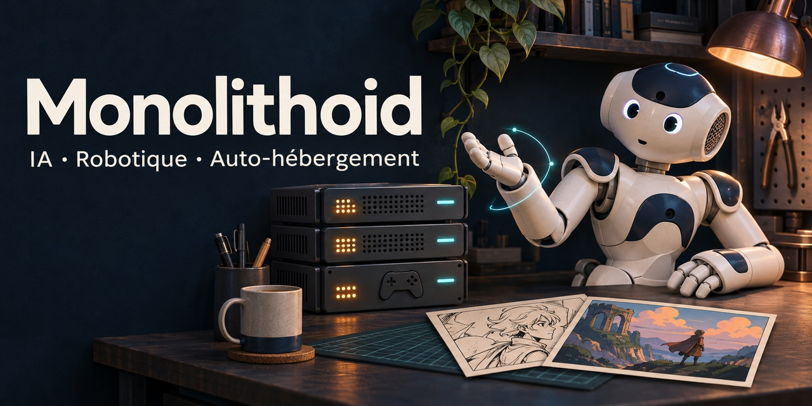

# Monolithoid

**IA · Robotique · Serveurs de jeux · Web & médias**

[English](README.md) · **Français**

Bienvenue sur mon profil GitHub ! Je développe des projets autour de l’intelligence artificielle, de la robotique et d’outils pour héberger, automatiser et partager des contenus. Mes dépôts vont de l’aide à la création de bandes dessinées aux mouvements expressifs d’un robot NAO, en passant par la gestion de serveurs de jeux coopératifs.

### IA & création

- **[ia-agent](https://github.com/Monolithoid/ia-agent)** — Mon projet d’agent d’intelligence artificielle, en Python.
- **[ia-bd](https://github.com/Monolithoid/ia-bd)** — Une stack IA pour m’accompagner dans la création de bandes dessinées, en JavaScript.

### Robotique & expression

- **[nao-emotion-motion](https://github.com/Monolithoid/nao-emotion-motion)** — Apprentissage de mouvements expressifs des bras et de la tête de NAO à partir de démonstrations, en fonction de l’émotion et de son intensité. Projet en Python.
- **[NAO-V5-ressources](https://github.com/Monolithoid/NAO-V5-ressources)** — Fork du dépôt d’Aldebaran regroupant le manuel utilisateur et les ressources linguistiques de NAO v5.

### Jeux & infrastructure

- **[myCoopHub](https://github.com/Monolithoid/myCoopHub)** — Gestion de serveurs de jeux coopératifs sur Coolify via une interface web et des automatisations Discord, en JavaScript.
- **[steamcmd-servers](https://github.com/Monolithoid/steamcmd-servers)** — Une base de serveurs dédiés utilisant SteamCMD, avec ou sans Wine, en Shell.

### Web & médias

- **[galleryPerso](https://github.com/Monolithoid/galleryPerso)** — Mise à disposition sur le web des fichiers d’un dossier hébergé sur un VPS, en PHP.
- **[streamEvent](https://github.com/Monolithoid/streamEvent)** — Diffusion d’événements en streaming, notamment sportifs, en Python.

**Technologies présentes dans mes projets :** Python, JavaScript, PHP, Shell, Coolify, Discord, SteamCMD, Wine et NAO.

### Assistance IA

Je réalise ces projets avec l’aide des outils d’OpenAI et de Claude (Anthropic).
